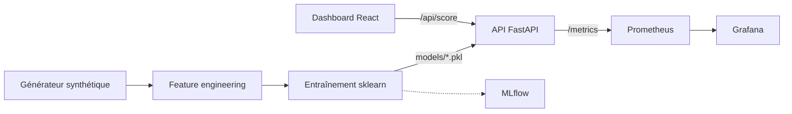

# Mobile Money Fraud

Détection de fraude sur des transactions Mobile Money : génération de données synthétiques, entraînement de modèles scikit-learn, API de scoring FastAPI et tableau de bord React de surveillance.

## Problème résolu

Les transactions Mobile Money (transferts, paiements, retraits, recharges, paiement de factures) sont exposées à plusieurs schémas de fraude : prise de contrôle de compte, carte volée, réseau de mules, identité synthétique, smishing. La fraude est très rare (0,15 % dans les données synthétiques du projet), ce qui impose un traitement adapté du déséquilibre de classes, un découpage temporel strict pour éviter les fuites d'information, et des métriques adaptées (AUC-PR, rappel à FPR fixé, lift).

Le dépôt couvre la chaîne complète : données, features, modèles, service de scoring explicable, supervision.

## Fonctionnalités

- Générateur de transactions synthétiques pour 8 pays de l'UEMOA, 3 opérateurs, 5 types d'opérations et 5 scénarios de fraude injectés (`src/data/generator.py`).
- Feature engineering avec paramètres appris sur l'entraînement et réappliqués au test (`src/features/engineering.py`).
- Entraînement de quatre modèles : Isolation Forest, Random Forest, régression logistique, VotingClassifier (`src/models/train.py`).
- Métriques orientées fraude : AUC-ROC, AUC-PR, rappel à FPR 1 %, précision à rappel fixé, lift, analyse coût-bénéfice (`src/evaluation/metrics.py`).
- Suivi des expériences MLflow (tracking, registry) lorsqu'un serveur est joignable ; l'entraînement fonctionne sans.
- Surveillance de dérive par PSI sur la distribution des scores (`src/evaluation/monitor.py`).
- API FastAPI : `/score`, `/score/batch` (100 transactions maximum), `/health`, `/metrics` (Prometheus). Le seuil de blocage est fixé à 0,5 dans `api/main.py`. Les facteurs de risque sont calculés par SHAP lorsque le paquet `shap` est installé.
- Tableau de bord React (Vite, TypeScript, Tailwind) : flux de transactions simulé côté navigateur et scoré par l'API, alertes, fiche d'investigation, retours analyste, centre d'audit des transactions bloquées avec export CSV.
- Supervision : Prometheus (règles d'enregistrement) et Grafana (dashboard provisionné).

## Architecture



Le modèle servi par l'API est le Random Forest (`models/RandomForest.pkl`), accompagné de `models/metadata.pkl` (liste des features et histogramme de référence des scores).

## Stack technique

| Couche | Technologies |
|---|---|
| Données et modèles | Python, pandas, NumPy, scikit-learn, joblib, SHAP |
| API | FastAPI, Uvicorn, Pydantic, prometheus_client |
| Suivi ML | MLflow |
| Tableau de bord | React, TypeScript, Vite, Tailwind CSS, Radix UI |
| Supervision | Prometheus, Grafana |
| Déploiement | Docker, Docker Compose, Nginx |
| Tests | pytest |

## Installation

Prérequis : Python 3.11 ou supérieur, Node.js 20 ou supérieur (dashboard), Docker (optionnel).

```bash
git clone <url-du-depot>
cd mobile-money-fraud
python -m venv .venv
source .venv/bin/activate          # Windows : .venv\Scripts\activate
pip install -r requirements-dev.txt
cp .env.example .env
```

## Usage

### 1. Générer les données

```bash
# Jeu complet (500 000 transactions, écrit dans outputs/, ignoré par git)
python -m src.data.generator

# Petit jeu de test
python -m src.data.generator --n-transactions 6000 --n-accounts 600 --output data/sample
```

L'échantillon versionné dans `data/sample/` provient de la seconde commande. Les données sont entièrement synthétiques.

### 2. Entraîner les modèles

```bash
python scripts/train_pipeline.py
```

Le script lit `outputs/transactions.csv` et `outputs/accounts.csv` (ou le dossier indiqué par `DATA_DIR`) et écrit les modèles dans `models/`. Avec l'échantillon : `DATA_DIR=data/sample python scripts/train_pipeline.py`. Le découpage temporel du pipeline est train avant le 2025-07-01, test à partir de cette date ; un jeu trop petit contient très peu de fraudes et donne des métriques peu significatives.

Suivi MLflow facultatif :

```bash
export MLFLOW_TRACKING_URI=http://localhost:5002
python scripts/register_mlflow.py
```

### 3. Lancer l'API

```bash
uvicorn api.main:app --port 8002
curl -X POST http://localhost:8002/score \
  -H "Content-Type: application/json" \
  -d '{"amount": 250000, "transaction_type": "transfer", "channel": "ussd", "operator": "MTN", "timestamp": "2025-08-02T03:10:00", "sender_account_age": 5, "sender_sim_swap_recent": 1}'
```

### 4. Lancer le tableau de bord

```bash
cd dashboard-react
npm ci
npm run dev        # http://localhost:5173, proxy /api vers localhost:8002
```

### 5. Pile complète avec Docker

```bash
# models/ doit exister (étape 2) ; GRAFANA_ADMIN_PASSWORD doit être défini dans .env
docker compose up --build
```

| Service | Port |
|---|---|
| API | 8002 |
| Dashboard | 8502 |
| MLflow | 5002 |
| Prometheus | 9090 |
| Grafana | 3001 |

## Structure du dépôt

```
api/                 API FastAPI (main.py)
src/
  data/              générateur de données synthétiques
  features/          feature engineering
  models/            entraînement des modèles
  evaluation/        métriques, monitoring PSI
  inference.py       détecteur utilisé par l'API (chargement, features, SHAP)
scripts/             pipeline d'entraînement, enregistrement MLflow
notebooks/           exploration et modélisation
dashboard-react/     tableau de bord React
monitoring/          Prometheus et Grafana
docker/              Dockerfiles API et dashboard, configuration Nginx
data/sample/         échantillon synthétique (6 000 transactions)
tests/               tests pytest
```

## Tests

```bash
python -m pytest tests
```

Les tests de l'API et de l'inférence sont ignorés (`skip`) tant que `models/RandomForest.pkl` est absent ; entraîner les modèles au préalable pour les exécuter. `tests/test_monitor.py` requiert `mlflow`.

## Limites connues

- Les données sont synthétiques ; les performances obtenues sur elles ne préjugent pas de celles sur des flux réels.
- Le dashboard génère ses transactions dans le navigateur et ne se connecte pas à une source de production ; les retours analyste ne sont conservés qu'en mémoire, sans persistance.
- Le seuil de décision (0,5) est codé en dur dans l'API.
- L'API n'a pas d'authentification et la configuration CORS ne couvre que les ports de développement locaux.
- Les modèles ne sont pas versionnés dans le dépôt : ils doivent être régénérés.
- Le dashboard n'a pas de tests automatisés.

## Licence

Licence : tous droits réservés. Voir le fichier `LICENSE`.

## Contact

Jean-Paul ADOGLI, étudiant ingénieur en data science et big data, GitHub : [Jean-Paul15](https://github.com/Jean-Paul15).
