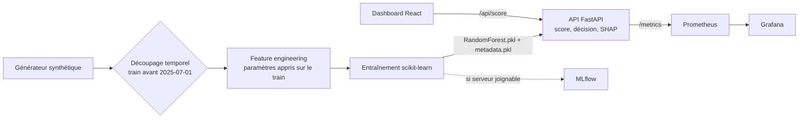

# Mobile Money Fraud

Un service qui note chaque transaction Mobile Money entre 0 et 1, la bloque au-dessus de 0,5 et dit pourquoi, alors que la fraude y est si rare qu'un modèle naïf peut l'ignorer sans jamais se tromper.

## Ce que ça apporte

- **Une évaluation sans fuite temporelle.** Le jeu est coupé au 2025-07-01 avant tout calcul de features. Les moyennes par émetteur sont apprises sur l'entraînement puis réutilisées telles quelles sur le test. La fenêtre glissante de 24 heures exclut la transaction courante (`closed="left"`).
- **Des décisions expliquées.** Chaque réponse de `/score` contient les facteurs de risque calculés par SHAP, traduits en libellés lisibles pour un analyste.
- **Une chaîne observable de bout en bout.** Le service expose des métriques Prometheus, un dashboard Grafana provisionné, un calcul de dérive PSI sur les scores et un suivi MLflow facultatif.

## Le problème

Un transfert de 250 000 FCFA à 3 h du matin, par USSD, depuis un compte ouvert il y a cinq jours et dont la SIM vient de changer. Légitime ou prise de contrôle de compte ? Une règle fixe hésite. Dans les données synthétiques du projet, la fraude représente 0,15 % des transactions. Un modèle qui répond toujours « légitime » obtient donc 99,85 % d'exactitude et ne sert à rien. Le dépôt traite ce déséquilibre : pondération des classes, découpage temporel strict, et métriques faites pour la fraude (AUC-PR, rappel à taux de faux positifs de 1 %, lift, analyse coût-bénéfice).

## Démarrer en cinq minutes

Prérequis : Python 3.11 ou supérieur, Node.js 20 ou supérieur pour le dashboard.

```bash
pip install -r requirements-dev.txt
DATA_DIR=data/sample python scripts/train_pipeline.py
uvicorn api.main:app --port 8002
curl -X POST http://localhost:8002/score -H "Content-Type: application/json" -d '{"amount": 250000, "transaction_type": "transfer", "channel": "ussd", "operator": "MTN", "timestamp": "2025-08-02T03:10:00", "sender_account_age": 5, "sender_sim_swap_recent": 1}'
cd dashboard-react && npm ci && npm run dev
```

L'échantillon versionné compte 6 000 transactions dont 9 fraudes : il suffit pour lancer la chaîne, pas pour juger le modèle. Pour le jeu complet de 500 000 transactions, lancez `python -m src.data.generator`, puis l'entraînement sans `DATA_DIR`. Le dashboard s'ouvre sur `http://localhost:5173` et appelle l'API via un proxy `/api`. Pour toute la pile (API, dashboard, MLflow, Prometheus, Grafana), `docker compose up --build` après avoir défini `GRAFANA_ADMIN_PASSWORD` dans `.env` (modèle : `.env.example`).

## Comment ça marche



Trois choix structurent le dépôt.

**Couper avant de transformer.** Une moyenne calculée sur tout le jeu laisse le futur filtrer dans le passé et gonfle les scores. Le découpage vient donc en premier. `engineer_features_train` renvoie les paramètres appris (moyennes par émetteur, première transaction par compte) et `engineer_features_test` ne fait que les relire.

**Un seul modèle servi, quatre entraînés.** Isolation Forest, Random Forest, régression logistique et un VotingClassifier sont comparés à l'entraînement. L'API charge uniquement le Random Forest, avec un `metadata.pkl` qui porte la liste des features et l'histogramme de référence des scores. Le service reste simple, et la dérive se mesure par PSI contre cette référence.

**Un détecteur isolé de l'API.** `src/inference.py` reconstruit les features d'une transaction, prédit et explique. `api/main.py` s'occupe du HTTP, des métriques et de la décision. Le détecteur se teste sans serveur. Si `shap` manque, l'explication renvoie une liste vide et le score reste servi.

## Stack technique

| Couche | Technologies |
|---|---|
| Données et modèles | Python, pandas, NumPy, scikit-learn, joblib, SHAP |
| API | FastAPI, Uvicorn, Pydantic, prometheus_client |
| Suivi ML | MLflow |
| Tableau de bord | React, TypeScript, Vite, Tailwind CSS, Radix UI |
| Supervision | Prometheus, Grafana |
| Déploiement | Docker, Docker Compose, Nginx |
| Tests | pytest |

## Structure du dépôt

```
api/                 API FastAPI : /score, /score/batch (100 max), /health, /metrics
src/
  data/              générateur synthétique : 8 pays UEMOA, 3 opérateurs, 5 scénarios de fraude
  features/          feature engineering sans fuite
  models/            entraînement des modèles
  evaluation/        métriques orientées fraude, PSI
  inference.py       détecteur utilisé par l'API (features, score, SHAP)
scripts/             pipeline d'entraînement, enregistrement MLflow
notebooks/           exploration et modélisation
dashboard-react/     tableau de bord de surveillance
monitoring/          Prometheus et Grafana
docker/              Dockerfiles et configuration Nginx
data/sample/         échantillon synthétique de 6 000 transactions
tests/               tests pytest (python -m pytest tests)
```

Les tests de l'API et de l'inférence sont ignorés tant que `models/RandomForest.pkl` n'existe pas : entraînez d'abord. `tests/test_monitor.py` demande `mlflow`.

## Limites et suite

Le périmètre est un choix : montrer une chaîne de détection complète et propre sur des données que je peux publier.

- Les données sont synthétiques. Les performances obtenues ne disent rien d'un flux réel, et c'est assumé.
- Le dashboard génère ses transactions dans le navigateur. Les retours analyste restent en mémoire.
- Le seuil de 0,5 est fixé dans l'API. Le rendre configurable est la suite la plus directe.
- L'API n'a pas d'authentification et son CORS ne couvre que les ports de développement locaux.
- Les modèles ne sont pas versionnés : `scripts/train_pipeline.py` les régénère.
- Le dashboard n'a pas encore de tests automatisés.

## Licence

Tous droits réservés. Lecture du code autorisée pour évaluation. Voir `LICENSE`.

## Contact

Jean-Paul ADOGLI, étudiant ingénieur en data science et big data. GitHub : [Jean-Paul15](https://github.com/Jean-Paul15).
